<h1 align="center">pocketomv 📊</h1>

<p align="center">
  
  
  
  <a href="LICENSE"></a>
</p>

<p align="center">
  An offline Android alternative to jamovi for common statistical analyses.
</p>

<p align="center">
  <strong>Data → Analyze → Results</strong>
</p>

## Overview

pocketomv was built specifically for offline statistical analysis on Android, to avoid interruptions from jamovi Cloud session limits. It supports common analyses and is not a full replacement for jamovi.

Enter a table, choose a worksheet from an Excel workbook, or open a CSV/TSV file. Select an analysis and its variables, then review statistics, distributions, available confidence intervals and method notes. Copy the report or save it as text, HTML or PDF.

Current work saves automatically in private device storage. The app restores applied data, unfinished edits, analysis options and the current screen when reopened, and recalculates saved results.

## Features

- Statistical analyses covering descriptives, internal consistency, comparisons of means and ranks, frequencies, correlation and regression.
- Factorial ANOVA with interactions and Type I/II/III sums of squares; ANCOVA with numeric covariates, adjusted means, Tukey comparisons and slope checks.
- Exploratory common-factor analysis with MINRES/principal axis extraction, Oblimin/Varimax/Promax rotation, factor retention, KMO, Bartlett's test and scree plots.
- Mean, optional weighted mean, median, mode, sample/population variance and standard deviation, and custom percentiles.
- Multiple-variable descriptives split by an optional group, with adjusted sample skewness and excess kurtosis.
- Numeric or categorical frequency tables, plus numeric histograms with automatic or custom intervals.
- Optional categorical frequency bar charts.
- Optional boxplots, normal Q–Q plots and scatterplots, with a fitted line for simple regression.
- Separate Data, Analyze and Results screens.
- Data entry with optional column headings, direct Excel `.xlsx` import with worksheet selection, and CSV/TSV import.
- A cell grid with row/column editing, one-step undo, recoding, reverse scoring and item sum/mean scores.
- Student and Welch options for independent t tests, plus ordinary and Welch one-way ANOVA.
- Optional Shapiro–Wilk normality checks for t tests and one-way ANOVA, plus mean- or median-centered Levene checks for independent groups.
- ANOVA pairwise comparisons with Tukey–Kramer or Games–Howell, adjusted p-values and 95% intervals.
- Reliability with raw/standardized Cronbach's alpha, one-factor McDonald's omega, item-rest correlations and alpha if an item is removed.
- Multiple linear regression with 1–12 numeric predictors, coefficient intervals, standardized coefficients, VIF and optional residual diagnostics.
- Pearson or Spearman correlation matrices with pairwise/listwise missing-value handling, sample sizes, p-values and optional Pearson intervals.
- Repeated-measures ANOVA for one within-subject factor, with sphericity corrections and optional paired follow-up comparisons.
- Directional alternatives for supported tests and custom expected weights for goodness of fit.
- Fisher's exact test for 2 × 2 tables, plus Phi, signed Phi, odds ratios and relative risks with explicit group/event choices.
- Friedman repeated-condition rank tests with Kendall's W and optional Durbin–Conover follow-ups.
- Explicit handling of missing values, tied ranks, zero paired differences and frequency counts.
- Descriptive statistics, available 95% confidence intervals and calculation notes.
- A fictional example for every analysis.
- Automatic work recovery with visible saving status and Retry after a failed save.
- CSV data export, report copying, text reports and self-contained PDF/HTML reports with tables and figures.
- Portrait, landscape, larger text and dark mode.

## Supported analyses

| Area | Analyses |
| --- | --- |
| Descriptives | Single/multiple-variable and grouped summaries, skewness, excess kurtosis, percentiles, frequencies, histograms and categorical bar charts |
| Means | One-sample, independent-samples and paired-samples t tests |
| Group means | One-way and factorial ANOVA, ANCOVA, one-factor repeated-measures ANOVA |
| Ranks | Mann–Whitney U, Wilcoxon signed-rank, Kruskal–Wallis H and Friedman |
| Frequencies | Chi-square goodness of fit and independence; Fisher's exact test for 2 × 2 tables |
| Association | Pairwise Pearson and Spearman correlation; multiple-variable correlation matrices |
| Prediction | Simple and multiple linear regression |
| Reliability | Cronbach's alpha, one-factor McDonald's omega and item diagnostics |
| Factor analysis | MINRES/principal axis EFA; Oblimin/Varimax/Promax; fixed, eigenvalue and parallel retention; KMO/MSA, Bartlett and scree plots |

Mann–Whitney and Wilcoxon use exact probabilities for eligible small samples and corrected approximations otherwise. Zero paired differences are removed before Wilcoxon ranks are assigned. Spearman uses exact permutation probabilities for small untied samples, AS 89 for larger untied samples, and a t approximation for ties or more than 1,290 pairs. Method notes identify the calculation used for each result.

### Assumption checks and ANOVA follow-ups

For a t test or one-way ANOVA, enable **Shapiro–Wilk normality** in **Analyze**. Independent-samples t tests default to pooled group-centered residuals; one-way ANOVA uses standardized model residuals, as in jamovi. Separate-group or combined views remain available, and older saved sessions retain their separate-group settings. One-sample tests check the selected sample and paired tests check differences. Independent-samples t tests and one-way ANOVA also offer **Levene variance check**, using group means by default with a median option. Older sessions retain medians. Undefined checks display an explanation while retaining the main analysis.

For ANOVA, enable **pairwise comparisons** to identify differences between individual groups. The variance choice selects **Tukey–Kramer** for ordinary equal-variance ANOVA or **Games–Howell** for Welch ANOVA. Results include signed mean differences, standard errors, t statistics, degrees of freedom, adjusted p-values and 95% intervals. Reports include all comparisons; the screen shows up to 100.

These options start unchecked. Diagnostic p-values do not automatically change the main analysis, and a nonsignificant check does not prove an assumption. Independence depends on study design. See [calculation details, interpretation and sources](docs/statistical-methods.md).

<p align="center">
  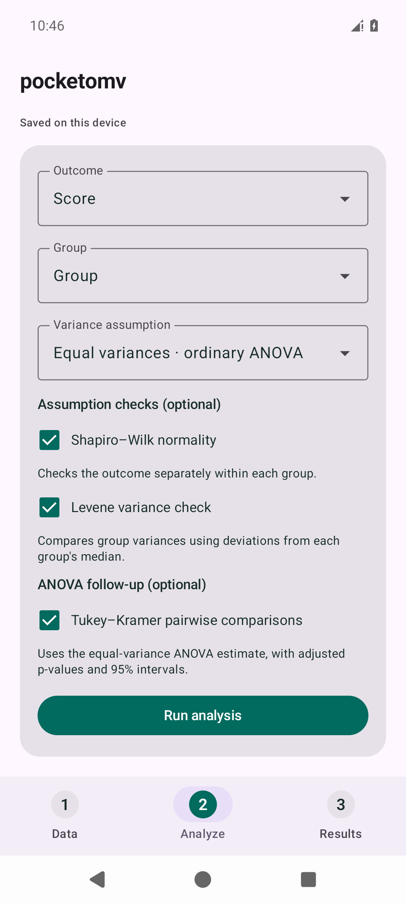
</p>

### Descriptives

Choose **Descriptives** in **Analyze**, select 1–20 variables, and choose **Numeric** or **Categories / text**. The data type applies to all selected variables. **Split by** optionally summarizes each variable separately within a group. Numeric data supports an optional weight column, sample or population variance and standard deviation, custom percentiles, and 1–50 histogram intervals. Leave the interval count blank for automatic selection.

Grouped results include an overview table and a **Detailed distribution** selector for the individual summaries, percentiles, histograms and frequency tables. Each variable uses its own non-missing observations; a missing answer in another variable does not remove a valid value. Groups with no valid values remain visible with N = 0. Blank group labels are excluded, while literal labels such as `NA` are retained. Use at most 40 groups and 200 variable/group combinations.

Grouped frequency tables show percentages of the variable's pooled valid N, as in jamovi, plus a separate within-group percentage column. Shared category levels include zero counts. If the full grid exceeds 200,000 cells, a note explains that zero-count rows are omitted; every observed count and percentage remains available.

- Weights affect **only the weighted mean**. Other statistics, frequencies and histogram bars count each non-missing row once. Missing and zero weights are omitted from the weighted mean; negative weights are rejected.
- Sample variance uses `n − 1`; population variance uses `N`. Sample variance and standard deviation are unavailable with only one observation.
- Skewness uses the adjusted Fisher–Pearson sample coefficient and needs at least three observations. Bias-corrected excess kurtosis needs at least four; its normal-distribution reference is zero. Both are unweighted, need nonconstant data, and retain their sample convention when the variance/SD option changes.
- Percentiles use [R type 7 linear interpolation](https://stat.ethz.ch/R-manual/R-patched/library/stats/html/quantile.html). Up to 20 percentiles from 0 to 100 can be requested. Leave the field blank to omit the percentile table.
- Mode shows the first value in sorted order when several values share the highest frequency, as in jamovi's numeric summaries. Tied modes are listed separately, including all-distinct and uniformly frequent samples. Long tie lists refer to the full frequency table.
- Histograms use equal-width intervals and the Sturges rule for automatic interval counts. Intervals include the lower boundary; the final interval also includes the upper boundary. Constant data produces one bar.
- The screen shows up to 100 distinct values in the frequency table. The text report contains the complete table, including the histogram's interval counts.
- In **Categories / text**, enable **Bar chart (category counts)** for frequency bars. Charts show the first 20 observed categories in label order; every observed category remains in the frequency tables and reports.

Category summaries treat blanks as missing and retain text such as `NA` as a category. Descriptives reports do not include a hypothesis test or p-value.

### Correlation matrices

Choose **Correlation matrix**, select 2–20 numeric variables and choose **Pearson r** or **Spearman rho**. Results contain coefficient, two-sided p-value and sample-size matrices, followed by details for every distinct pair. Tables scroll sideways on the phone and are retained in text, PDF and HTML reports.

- **Pairwise** uses available observations separately for each pair and reranks Spearman values within those rows. Each pair can have a different N.
- **Listwise** uses the same complete rows across all selected variables. Other columns do not determine which rows are included.
- Constant variables and insufficient data produce explained blank cells while retaining other results. Coefficients need at least two complete observations; Pearson p-values need at least three and Spearman supports two. P-values are unadjusted for multiple correlations. Spearman inference depends on the pair's sample size and ties.
- Optional **95% Pearson confidence intervals** use Fisher's z approximation and need at least four complete observations. Spearman intervals are not provided. Self-correlations have no test or interval.

Pairwise matrices need not be positive semidefinite, so they are not automatically suitable as input to factor analysis. Correlation does not establish causation. See [statistical conventions](docs/statistical-methods.md#correlation-matrices).

### Graphs

In **Analyze**, enable the graphs you want before running the analysis. Numeric Descriptives, t tests and ANOVA offer **Boxplot** and **Normal Q–Q plot**. Rank comparisons offer boxplots. Pearson, Spearman and simple regression offer **Scatterplot**.

- Boxplots show R type 7 quartiles, the median, whiskers within 1.5 interquartile ranges and individual outliers. Outliers remain in the analysis. Group plots scroll sideways, with full labels and numerical summaries below.
- Normal Q–Q plots compare observed values with theoretical normal quantiles. A reference line passes through the first and third quartiles. For independent groups, choose a **Q–Q sample**; paired t tests plot the differences within complete pairs. Small or constant samples include an explanation. A graph alone does not establish normality.
- Scatterplots show every complete pair using the original values, including for Spearman correlation. Simple regression adds its fitted least-squares line. Overlapping values share a marker.

Graph options and the selected Q–Q sample are saved with your work. Text reports include numerical graph summaries. PDF and HTML reports include the requested figures, including every Q–Q group. Multiple regression offers residual Q–Q and residuals-versus-fitted plots; repeated-measures ANOVA offers condition boxplots. See [graph conventions and references](docs/statistical-methods.md#graphs).

<p align="center">
  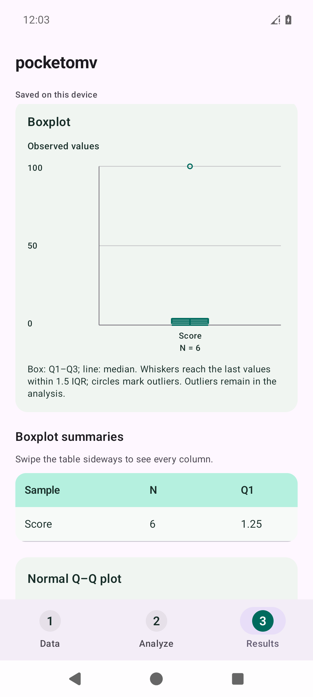
  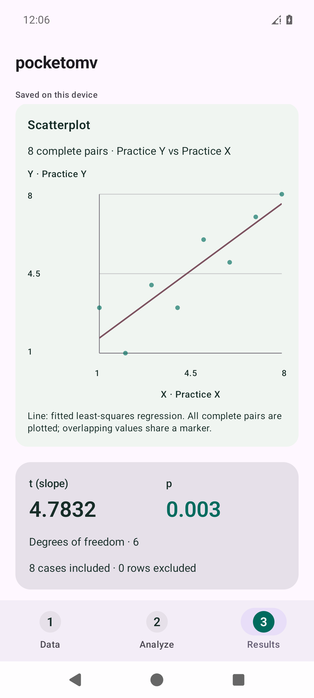
</p>

### Reliability analysis

Choose **Reliability analysis**, select 2–60 item columns and run. Results include raw and standardized alpha and omega, item means/SDs, corrected item-rest correlations and raw alpha if each item is removed. Enable the inter-item correlation table when useful. All values use the same complete participants. Use the Data scoring tools to reverse negatively keyed items first; the app never reverses or removes items automatically.

Omega uses a single congeneric factor fitted by minimum residuals (MINRES) and needs at least three items. Standardized omega follows jamovi's correlation-based definition, using observed total-score variance. Raw omega uses the items' original variances. Singular correlations, constant items, weak identification and boundary solutions produce an explanation instead of a coefficient. Internal consistency does not establish validity or a single underlying dimension.

### Multiple linear regression

Choose an **Outcome** and 1–12 separate numeric **Predictors**. The model includes an intercept and enters all predictors together. Results include overall F and p, R²/adjusted R², RMSE, residual standard error, coefficient B/SE/standardized β, two-sided t tests, 95% intervals, VIF and tolerance. RMSE uses N in its denominator; residual standard error uses residual degrees of freedom. Optional residual Shapiro–Wilk, Q–Q and residuals-versus-fitted plots support diagnosis. The Q–Q plot uses sample-standardized residuals and an identity reference line; the residuals-versus-fitted plot stays in the outcome's original units.

Categorical predictors require appropriately coded numeric indicators and a reference category. Constant or redundant predictors are rejected. The model needs more complete observations than predictors plus one. Interaction terms, automatic model selection and logistic regression are outside this model's scope.

### Repeated-measures ANOVA

Arrange one row per participant and one column per condition. Select 2–12 conditions, leaving the participant ID unchecked. The app fits one within-subject factor and reports F, partial eta-squared, Mauchly's sphericity diagnostic and uncorrected, Greenhouse–Geisser and Huynh–Feldt results. Greenhouse–Geisser is the default; choose the correction explicitly.

Optional paired follow-ups use **Holm-adjusted p-values** and **Bonferroni 95% family intervals**. These are different adjustments and are labeled separately. The main analysis and all follow-ups use the same complete participants. Two conditions need no sphericity correction. Multiple within-subject factors, between-subject factors and mixed models are outside this analysis's scope.

<p align="center">
  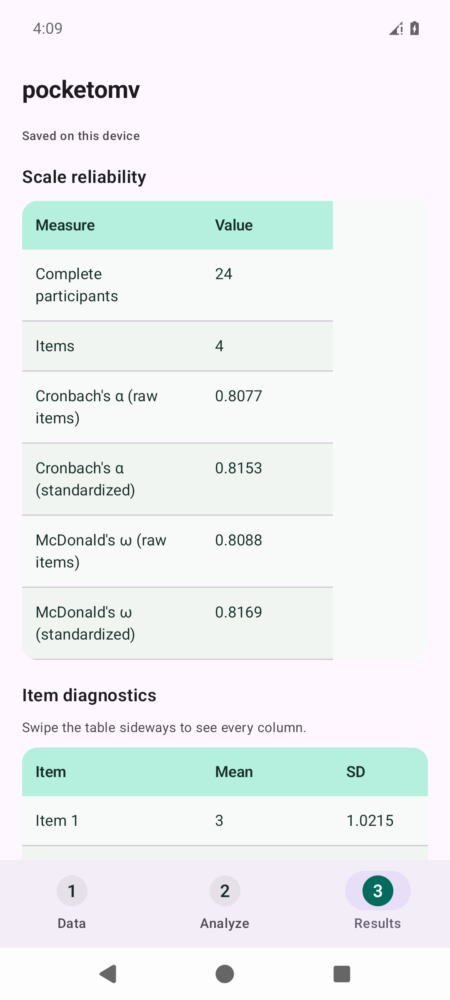
  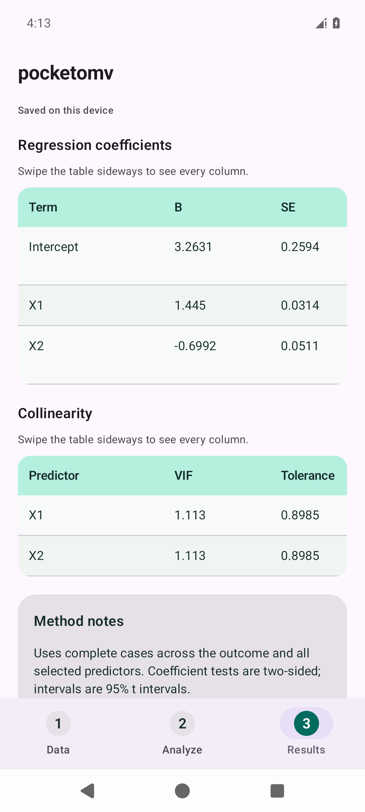
  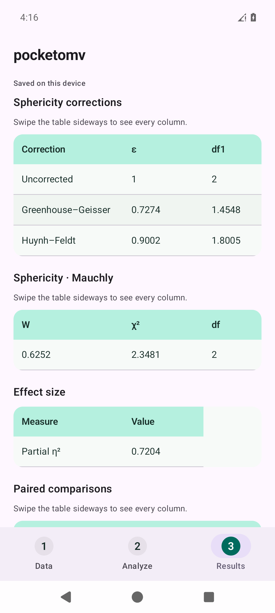
</p>

### Fisher's exact test and categorical association

Choose **Fisher's exact test (2 × 2)**, select the row and column category variables, and optionally select a frequency column. Without frequencies, each complete row is one observation. The table must have two nonempty categories in each variable. Exact tests support a total frequency up to 2,147,483,647 and at most 100,000 feasible tables under the fixed margins. Calculations beyond those limits produce an explanation. Chi-square independence may be suitable when its assumptions are met.

For a 2 × 2 table, choose the **Comparison group** and **Event category**. The other group is the reference. Fisher's alternatives test whether the selected event's odds ratio differs from, exceeds, or is below one. Results include observed/expected counts, an exact p-value, the sample odds ratio, Cramér's V and a table of Phi magnitude, signed Phi, odds ratio and relative risk. The same association measures appear with 2 × 2 chi-square independence analyses; larger tables retain Cramér's V.

Ratio intervals are approximate 95% log-Wald intervals. When any cell is zero, the odds-ratio measure adds 0.5 to all four cells, as in jamovi; a separate uncorrected row retains the original zero or infinite estimate. Fisher's exact p-value uses the original counts. Relative risks remain uncorrected and their intervals need positive event counts in both groups. Fisher's exact p-value and the approximate intervals are different calculations. Sample odds ratios can differ from conditional maximum-likelihood estimates.

### Friedman test

Use one row per participant and 3–12 numeric condition columns. Choose **Friedman test**, select the conditions and leave ID unselected. Results include the tied-rank chi-square approximation, degrees of freedom, p-value, Kendall's W, condition mean ranks and descriptive summaries. All results use the same complete participants. At least two complete participants are needed; the approximation can be unreliable with small samples or few conditions.

Enable **Durbin–Conover follow-up comparisons** for signed mean-rank differences, standard errors, t statistics, raw p-values and adjusted p-values. **Unadjusted** is the default; **Holm** and **Bonferroni** are available. Older saved sessions retain their previous adjustment. No residual rank variation makes follow-up tests unavailable while retaining a defined omnibus result. Optional boxplots use the same complete participants. Every option and result is included in saved work and reports. See [statistical conventions](docs/statistical-methods.md#friedman-and-follow-up-comparisons).

### Factorial ANOVA and ANCOVA

Use a numeric outcome and 2–3 categorical factors for **Factorial ANOVA**, or 1–3 factors plus 1–6 numeric covariates for **ANCOVA**. Numeric factor labels are treated as categories. Each factor can have 2–6 observed levels. Enable every factor interaction, including the three-way interaction with three factors, or choose an additive model.

Type III sums of squares with sum-to-zero contrasts are the default. Type II and sequential Type I are selectable. Results include a term table with partial η², the overall model test and model fit. Estimated marginal means weight the other factor levels equally and hold covariates at their complete-case means. Optional pairwise comparisons default to Tukey within each factor. Holm, Bonferroni and unadjusted comparisons are also available, with a selectable per-factor or all-displayed-pairs family. Older saved sessions retain their previous choices. Interpret interactions before averaged main effects.

Optional checks cover residual normality, variance homogeneity across observed factor cells, residual plots and, for ANCOVA, homogeneity of regression slopes. Homogeneity defaults to an ANOVA of absolute fitted-model residuals, as in jamovi; raw-cell median Levene remains selectable and is retained for older saved sessions. The slope check compares common slopes with added factor-term × covariate interactions. Rank-deficient models, unusable residual variation and calculations beyond the phone's model-size limits produce an explanation. See [model definitions and limits](docs/statistical-methods.md#factorial-anova-and-ancova).

### Exploratory factor analysis

Select 3–20 numeric items for **Exploratory factor analysis**. Choose MINRES or principal axis extraction, then no rotation, orthogonal Varimax, or oblique Oblimin/Promax. Oblimin is the default. Both oblique methods permit factor correlations and report both pattern and structure matrices. The loading threshold changes only what is displayed. Negatively keyed items must be reverse-scored in Data when appropriate.

Factor count can be fixed, selected by an eigenvalue threshold or suggested by parallel analysis. The default parallel method compares common-factor eigenvalues with 95th-percentile thresholds from 20 Gaussian null datasets. A visible seed makes results repeatable; match the seed and extraction settings when comparing with jamovi. It suggests at least one factor, while the model still needs to pass the extraction checks. A separate 200-simulation PCA/Wishart alternative remains available, and older saved sessions retain their earlier choices. Supported counts have nonnegative nominal model degrees of freedom, up to six factors.

Results include observed eigenvalues, loadings, communalities, uniquenesses, factor correlations and residual correlation fit. Optional KMO/MSA, Bartlett's sphericity test and a scree plot aid interpretation. Uses one complete-case sample with at least max(10, variables + 1) observations and Pearson correlations; ordinal/polychoric EFA is not included. See [extraction, rotation and retention conventions](docs/statistical-methods.md#exploratory-factor-analysis).

### PDF and HTML reports

In **Results**, choose **Save report as PDF** or **Save report as HTML**, then select a location in Android's file picker. Reports include the analysis settings, included/excluded counts, result tables, requested figures, preparation notes and method notes. Fictional data stays visibly labeled. Frequency tables retain every row, and all requested Q–Q samples are included.

- PDF uses A4 pages with vector charts, repeated table headings and separate column groups for wide tables. Exports are limited to 400 pages and 32 MB.
- HTML is one self-contained file with inline figures and styles, escaped text and no scripts or external resources. Wide tables scroll sideways on a phone to keep numbers readable. Open it in a browser to view or print it. Exports are limited to 32 MB.
- Long chart-axis labels are shortened to fit, with full variable names retained in captions. Boxplot summaries retain full condition names.
- Existing CSV and text exports remain available. The document picker and pending report restore after Android process termination.

## Preview

<p align="center">
  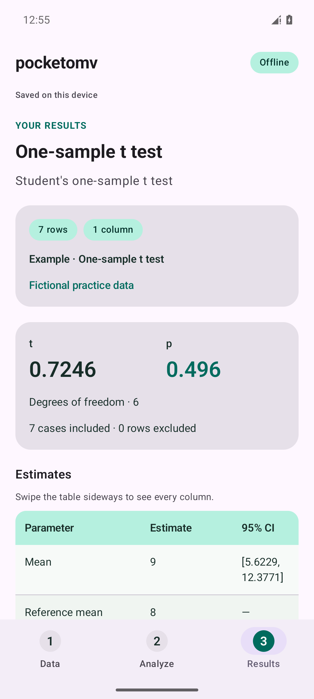
  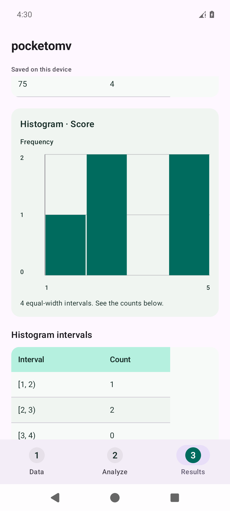
</p>

<p align="center">
  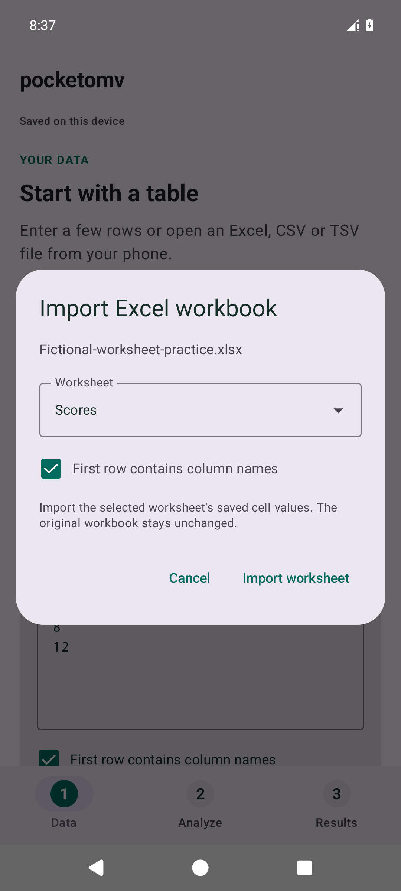
</p>

<p align="center"><em>Fictional practice data.</em></p>

## Use the app

1. In **Data**, enter rows or choose **Open Excel / CSV / TSV**. For Excel, select a worksheet, set whether its first row contains column names, then tap **Import worksheet**.
2. Choose **Use data**, then select the method and columns in **Analyze**.
3. Set the options for the selected analysis, such as sample/population summaries, a reference mean or a variance assumption.
4. Tap **Run analysis** and review the **Results** screen.
5. Copy the report, save it as text, HTML or PDF, or save the data as CSV.

**Saved on this device** confirms the current work has been written. Edited data must be applied before running an analysis. For a quick walkthrough, choose **Try fictional data** or **Load a fictional example** for the selected analysis.

### Edit cells and create scores

In **Data**, choose **Cells** in **Data editor**. Tap a cell to edit it, a column heading for rename/delete actions, or a row number for row actions. Add blank rows or columns, jump to a row, and undo the last table change during the current app session. Saved cell edits clear old results and recover when the app reopens.

Choose **Recode / score** to preview a separate recoded column, reverse-scored item, sum or mean. Recoding supports exact text and inclusive numeric ranges, with an explicit unmatched-value choice. Item scores can require every selected answer or a minimum number of answered items. Original values remain intact.

Scored columns contain **saved values calculated at creation**. Recreate scores after changing their inputs; they do not update automatically. Preparation notes accompany text reports. See [editing steps, scoring rules and examples](docs/data-editing.md).

<p align="center">
  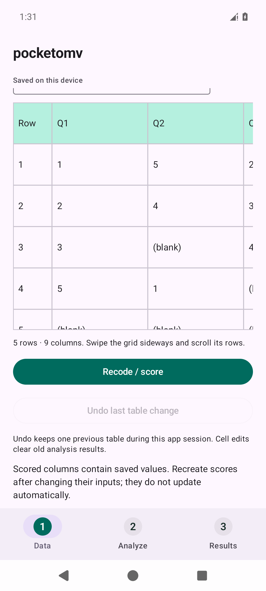
  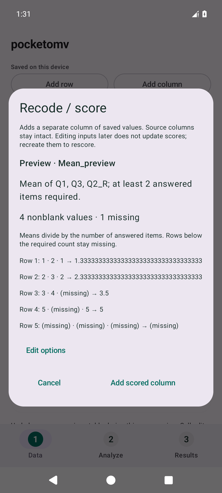
</p>

<p align="center"><em>Fictional questionnaire responses and score preview.</em></p>

### Data formats

Excel `.xlsx` workbooks open directly through Android's file picker. Choose one worksheet at a time, including a hidden worksheet when explicitly selected. Blank cells keep their column positions, fully blank rows are skipped, and the first nonblank row supplies column names when that option is checked. Cancelled or failed imports preserve the current table.

Excel imports stored cell values, including shared/inline text, numbers and Boolean values. [Formula cells use their last saved result](https://learn.microsoft.com/en-us/dotnet/api/documentformat.openxml.spreadsheet.cellvalue); formulas are not recalculated. Cells with missing formula results or Excel errors must be corrected before importing. Formatting, charts and merged-cell layout are not imported. Numeric date cells retain Excel's serial numbers; ISO date text stays text. Older `.xls`, binary `.xlsb` and encrypted workbooks are not supported.

Workbooks are limited to 8 MB, 100 worksheets and 32 MB of expanded content, with at most 8 MB in any individual part. Imported tables use the same row, column, cell and editable-text limits as entered data.

CSV/TSV import accepts UTF-8 and UTF-16 text with commas, tabs or semicolons as separators. Quoted fields and optional headers are supported.

For example, this fictional table can be used for an independent-samples comparison.

```csv
Group,Score
A,4
A,7
A,9
B,3
B,5
B,8
```

Numeric values use a decimal point. Blanks, `NA`, `N/A` and `NaN` are treated as missing in numeric columns. Frequency columns contain nonnegative whole numbers. Text files are limited to 2 MB; tables support at most 20,000 data rows, 60 columns and 250,000 cells.

## Privacy

The application declares no Android Internet permission. Calculations run on the device, and automatic session files use private storage excluded from Android backup.

Imports and exports use Android's document picker. Exported files are written to the location selected by the user.

## Install

Install the pocketomv APK on a phone running Android 8.0 or newer. Open the APK in your file manager and allow installation from that source when Android asks.

To update, install the newer APK over the existing app to retain saved work.

## License and acknowledgments

pocketomv's own code is available under the [MIT license](LICENSE). Third-party components retain their licenses and notices; see [acknowledgments](THIRD_PARTY_NOTICES.md). Tap **Licenses** in the app to read the included texts.

pocketomv is an independent application. It does not bundle jamovi or its R runtime and is not affiliated with or endorsed by the jamovi project. Supported methods and numerical conventions are described in the [statistical guide](docs/statistical-methods.md); identical results across every option and dataset are not claimed.
